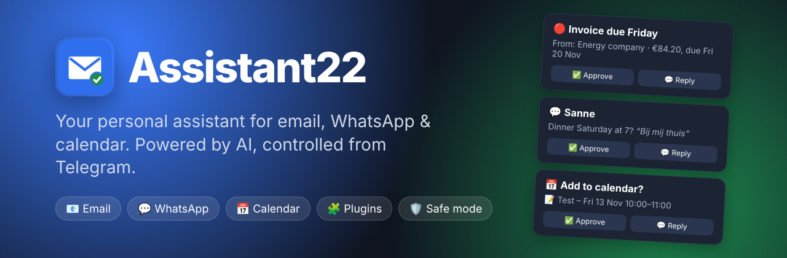
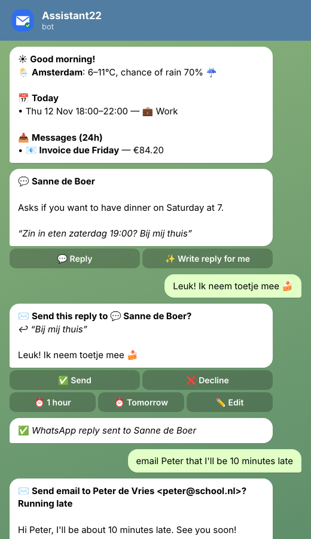
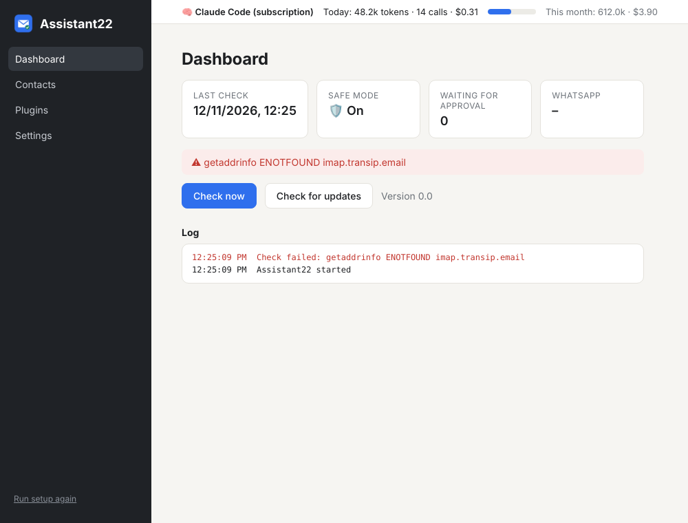
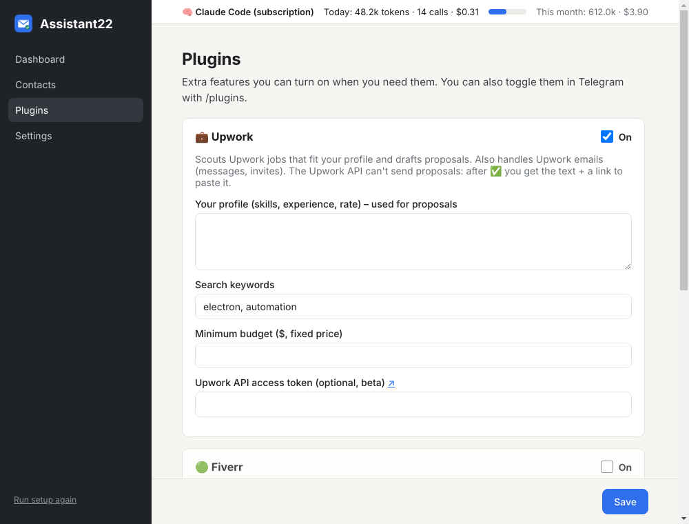
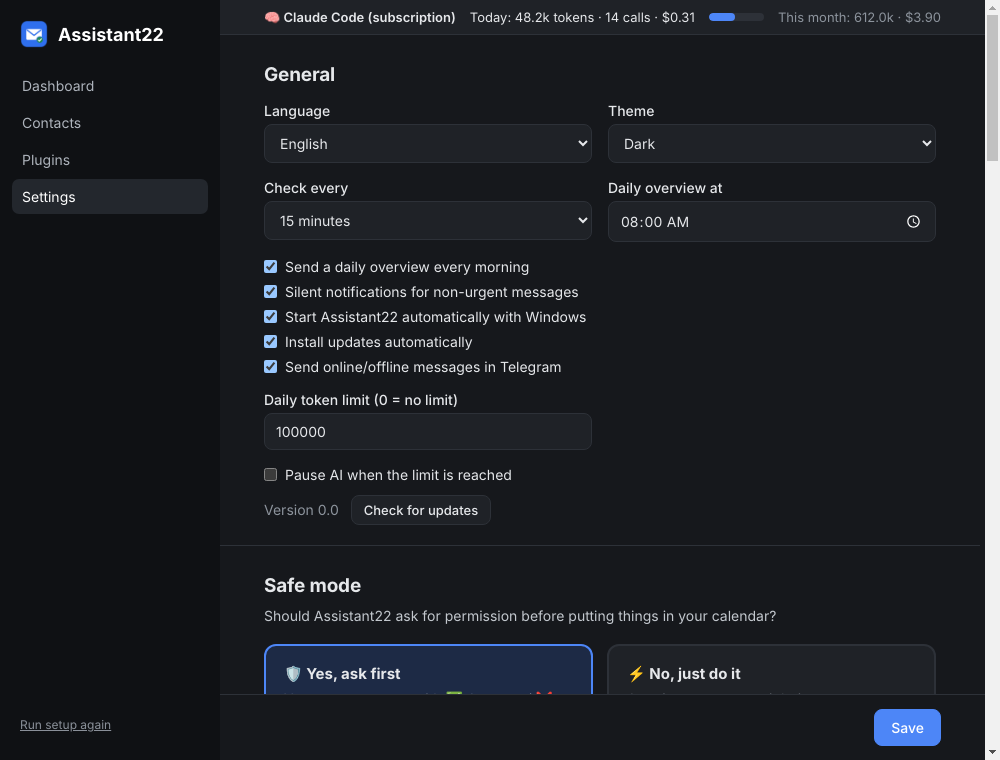
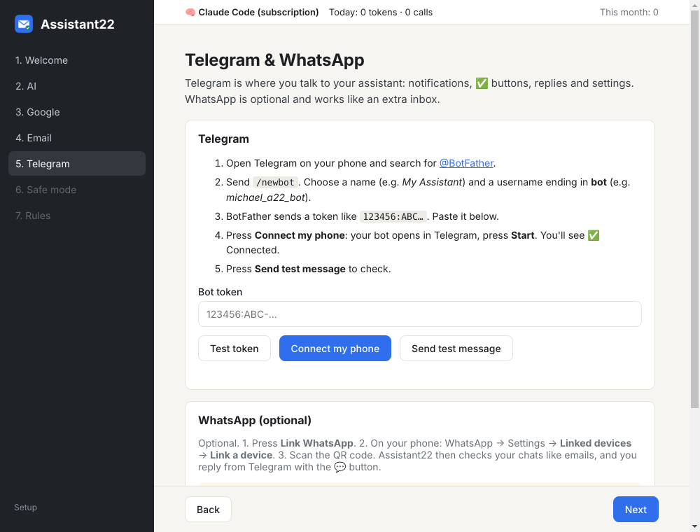

<p align="center">
  
</p>

<p align="center">
  <a href="https://github.com/mikeey77/Assistant22/releases/latest"></a>
  
  
  
</p>

# Assistant22

**Your personal assistant for email, WhatsApp and calendar.** Assistant22 reads your
inbox and WhatsApp, lets an AI decide what matters, puts appointments in Google
Calendar and talks to you on **Telegram**: notifications, ✅ approvals, replies,
new emails/WhatsApps and settings, all from your phone. Nothing is sent without your OK.

**[⬇️ Download the latest version](https://github.com/mikeey77/Assistant22/releases/latest)**

<table>
<tr>
<td width="44%" valign="top"></td>
<td valign="top">

### How it works
1. 📥 **Checks** your email and WhatsApp every few minutes
2. 🧠 **AI judges** each message using *your* rules (plain language)
3. 📲 **Telegram message** for what matters, with the message itself and buttons
4. 💬 **Reply** by tapping *Reply*, swiping the message, or letting the AI write it
5. ✅ **Approve** before anything is sent or added to your calendar
6. ☀️ **Morning overview**: agenda, weather and important messages

### Talk to it
- *"what's on tomorrow?"*
- *"email Peter that I'll be 10 minutes late"*
- *"whatsapp Sanne: see you tonight"*
- *"check every 30 minutes"* · *"turn on the Upwork plugin"*

</td>
</tr>
</table>

## Screenshots
| Dashboard | Plugins |
|---|---|
|  |  |
| **Settings (dark mode)** | **Setup: Telegram** |
|  |  |

## Features
- **Email**: Gmail (Google login) or any IMAP/SMTP account, settings detected from your address
- **WhatsApp** (optional): checked like an extra inbox (new chats within 2 minutes); send WhatsApps from Telegram
- **Google Calendar**: appointments from messages, daily overview every morning
- **Choose your AI**: Claude Code or ChatGPT Codex (on your subscription), Claude / OpenAI / Grok / Gemini API keys, or Ollama (local)
- **Usage bar**: tokens, calls and cost today and this month, optional daily limit that pauses the AI
- **Safe mode**: everything needs your ✅. Sending messages *always* needs approval
- Buttons: ✅ Approve · ❌ Decline · ⏰ 1 hour · ⏰ Tomorrow · ✏️ Edit (rewrite a draft in chat)
- **VIP senders** get urgent notifications with sound; everything else arrives silently
- **Reply from Telegram**: 💬 Reply / ✨ Write reply for me buttons under every message, or just swipe a message to reply
- **Contacts**: in the app, from Telegram, or tap 👤 under a notification
- **Settings from Telegram**: `/settings` buttons, or just type "check every 30 minutes"
- **Online/offline messages**: Telegram tells you when the app closes, the PC sleeps, or it was offline unexpectedly
- Light / dark / automatic theme (follows your device), English / Dutch (app *and* bot)
- Automatic updates via GitHub Releases, or check manually from the dashboard or tray menu

## Plugins
Off by default: turn them on in the app (**Plugins**) or in Telegram (`/plugins`).

| Plugin | What it does |
|---|---|
| 💼 Upwork | Scouts jobs that fit your profile and drafts proposals; handles Upwork emails. The Upwork API can't submit proposals, so after ✅ you get the text + a link to paste it. Job search needs an Upwork API token (beta). |
| 🟢 Fiverr | Reads Fiverr emails (buyer messages, Briefs, orders) and drafts replies/pitches to paste. Fiverr has no public API. |
| 👀 Website watcher | Tells you when a page changes in a way you care about (price, stock, news). |
| 📰 RSS / News | New items from feeds that match your keywords. |
| 🌦️ Weather | Today's weather + rain warning in your morning overview (Open-Meteo, free). |
| 🐙 GitHub | Your GitHub notifications (mentions, reviews, issues). |

Writing a plugin: add a file to `src/plugins/` with `id`, `name`, `icon`,
`description`, `settings` and any of `collect(ctx)` (new items to judge),
`claimsMail(mail)`, `hint(cfg)` (extra AI instructions), `dailyBrief(ctx)`,
and register it in `src/plugins/index.js`.

## Telegram
| Command | What |
|---|---|
| `/check` | Check now |
| `/today` (`/vandaag`) | Today's agenda |
| `/contacts` (`/contacten`) | Your contacts |
| `/settings` (`/instellingen`) | Settings with buttons |
| `/plugins` | Plugins on/off |
| `/usage` (`/verbruik`) | Token usage |
| `/status` | Status and waiting actions |
| `/safemode on` / `off` | Toggle safe mode |
| free text | "what's on tomorrow?", "email Peter that I'll be late", "whatsapp Sanne: see you tonight", "turn on the Upwork plugin" |

## Install
1. Download `Assistant22-Setup-x.y.z.exe` from [Releases](https://github.com/mikeey77/Assistant22/releases/latest).
2. Windows SmartScreen warns because the installer isn't signed: **More info → Run anyway**.
3. Follow the setup wizard. Later updates install themselves.

Requirements: Windows 10/11, a Telegram bot (via @BotFather), and one AI provider
(e.g. [Claude Code](https://docs.claude.com/en/docs/claude-code) logged in).
For Google Calendar/Gmail you create your own OAuth client ("Desktop app"); the
wizard explains how.

Assistant22 only runs while the app is open (it lives in the system tray and starts
with Windows).

## WhatsApp
WhatsApp is linked like WhatsApp Web (QR code, via the Baileys library). This is
**unofficial**: WhatsApp has no API for personal accounts, so there is a small risk
of your number being restricted.

## Development
```bash
npm install
npm start          # run the app
npm test           # engine tests
npm run dist       # build installer → dist/Assistant22-Setup-x.y.z.exe
```

## Publishing an update
1. Raise `version` in `package.json` and push to `main`.
2. On GitHub: **Actions → Release → Run workflow** (or push a tag like `v0.4.1`).
   The workflow builds the installer on Windows and publishes a GitHub Release.
3. Installed copies download the update and install it on the next restart.
   Settings are kept (`%APPDATA%\Postvak`, the original name).

## Structure
```
src/main.js                Electron: tray, window, IPC, autostart, updates, online/offline
src/engine.js              Core: check loop, actions, safe mode, snooze, VIP, Telegram commands & settings
src/i18n.js                All texts (en/nl)
src/config.js              Settings (secrets encrypted with Windows DPAPI)
src/plugins/               Optional plugins (Upwork, Fiverr, watcher, RSS, weather, GitHub)
src/services/ai.js         AI providers + token usage
src/services/mail.js       IMAP read, SMTP send
src/services/gmail.js      Gmail API read/send
src/services/autodetect.js Find IMAP/SMTP settings from an email address
src/services/google.js     Google OAuth + Calendar
src/services/telegram.js   Telegram Bot API (long polling)
src/services/whatsapp.js   WhatsApp via Baileys (QR link)
src/ui/                    Setup wizard, dashboard, contacts, plugins, settings
```
